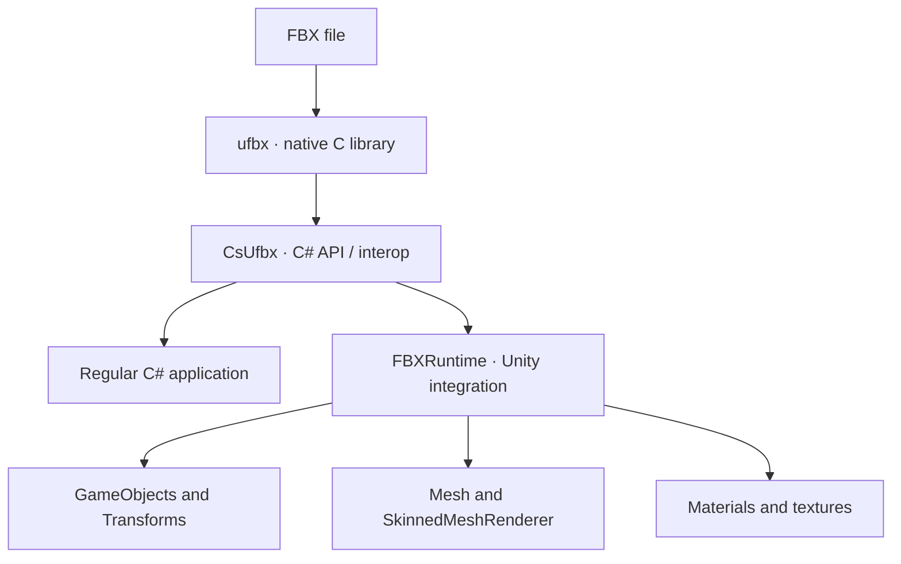

<div align="center">

# CsUfbx & FBXRuntime

**Load FBX files from C# and turn FBX scenes into Unity objects at runtime.**


[🇪🇸 Castellano](README.md) · [🇬🇧 English](README.en.md)

</div>

> [!WARNING]
> **Work in progress.** The basic loading and conversion workflow is implemented, but important features are still missing and some FBX files may not import correctly. The API and behavior may change between versions. This is not yet a complete or production-ready FBX importer.

## ✨ What is it?

This repository brings together two related components built around the native [**ufbx**](https://github.com/ufbx/ufbx) FBX loader:

- **`CsUfbx`** provides a C# API for accessing `ufbx` from **regular C# applications**, without depending on Unity classes. It is intended for desktop tools, .NET applications, command-line utilities, or other programs that need to inspect FBX data.
- **`FBXRuntime`** is the **Unity-specific** layer. It uses `CsUfbx` to read a scene and create Unity objects — `GameObject` hierarchy, transforms, meshes, skeletons, and materials — at runtime.

`CsUfbx` is not a fully managed FBX parser written only in C#: it acts as a C# bridge to the native `ufbx` library. Using it outside Unity still requires the correct native library and interop setup for the target platform.

## 🧩 How the pieces fit together



| Component | Purpose | Depends on Unity? |
|---|---|---|
| **ufbx** | Parses the FBX file and exposes its data. | No; it is the third-party native library. |
| **CsUfbx** | Exposes `ufbx` functions and structures through C#. | **No** `UnityEngine` dependency, but it does need the native library and interop. |
| **FBXRuntime** | Converts parsed data into objects that Unity can use. | **Yes**, it uses `UnityEngine`. |

## ✅ What already works

The current implementation provides a useful foundation for further development:

- Loading an FBX scene through `LoadScene`.
- Building the node hierarchy as `GameObject` objects and converting node transforms.
- Creating static meshes and using `SkinnedMeshRenderer` for meshes deformed by bones.
- Assigning bones, bind poses, and skin weights in the current workflow.
- Creating submeshes and assigning materials to meshes.
- Initial support for material properties such as base color, roughness, smoothness, and emission.
- Loading and assigning common textures, including external files and embedded image data, for channels such as base color, normals, and emission.
- Choosing a default lit shader for **Built-in Render Pipeline** and **URP**.

> These features provide a starting point, not a guarantee that every FBX file will work. Material conversion, UVs, skinning edge cases, and other data still need improvements and more testing.

## 🚧 Roadmap / known gaps

The list below reflects tasks left in comments in [`FBXRuntime.cs`](https://github.com/PabloGHub/CsUfbx-FBXRuntime/blob/master/FBXRuntime/FBXRuntime.cs), along with other parts of the code that are not implemented yet.

### Geometry and meshes

- [ ] Fix **UV mapping**.
- [ ] Read **tangents from the FBX** instead of relying on `Mesh.RecalculateTangents()`.
- [ ] Optimize mesh creation and processing.
- [ ] Complete remaining geometry, armature, and mesh-conversion cases.

### Skeletons, animation, and scene objects

- [ ] Handle vertices with no skin weights: interpolate using neighboring vertices when possible and, as a fallback, assign the first bone with a weight of `1.0`.
- [ ] Create and import **animations**.
- [ ] Create and import **BlendShapes**.
- [ ] Create Unity **cameras** from FBX cameras.
- [ ] Create Unity **lights** from FBX lights.
- [ ] Add configuration for choices such as interpreting the root in local or global space.

### Materials and textures

- [ ] Complete shader-property mapping and automatically assign textures to the corresponding properties.
- [ ] Avoid creating new `Texture2D` objects every time material properties are applied; reuse or cache textures.
- [ ] Complete handling for texture types that are currently commented out or unresolved, such as layered, procedural, and shader-generated textures.

### Export

- [ ] Implement exporting a Unity `GameObject` or scene to FBX. The `FBXRuntime` `Export(...)` methods are currently **WIP** and throw `NotImplementedException`.
- [ ] Implement saving scenes to a file through `CsUfbx`, which is also marked as TODO.

## 🚀 Minimal Unity example

`FBXRuntime` provides `LoadScene(...)` to read the file and `Instantiate(...)` to convert the loaded scene into Unity objects. Since the API uses pointers, the calling code must allow `unsafe` code.

```csharp
using Ufbx;
using Ufbx.Runtime;
using UnityEngine;

public static class FbxLoaderExample
{
    public static unsafe GameObject Load(string path)
    {
        ufbx_error error = default;
        ufbx_scene* scene = FBXRuntime.LoadScene(path, &error);

        if (scene == null)
        {
            Debug.LogError($"Could not load FBX: {error.description}");
            return null;
        }

        return FBXRuntime.Instantiate(scene);
    }
}
```

This snippet only demonstrates the basic load-and-instantiate flow. In a real application, also review the native scene's lifetime and memory cleanup, as well as error handling.

## 📦 Repository structure

```text
CsUfbx-FBXRuntime/
├── CsUfbx/             # C# interop and native ufbx source files
├── FBXRuntime/         # Conversion to Unity objects
└── Unity_6000.1.1f1/   # Unity project used for testing
```

## ⬇️ `ufbx`: repository and download

The latest version listed in the official changelog consulted for this documentation is **v0.23.1**, published on **September 24, 2026**. Get the source code here:

- **[Download ufbx v0.23.1 (ZIP)](https://github.com/ufbx/ufbx/archive/refs/tags/v0.23.1.zip)**
- [Official ufbx repository](https://github.com/ufbx/ufbx)
- [Official documentation](https://ufbx.github.io/)
- [Changelog / version history](https://github.com/ufbx/ufbx/blob/main/misc/changelog.md)

**Bundled version note:** the `ufbx.h` currently in this repository defines `UFBX_HEADER_VERSION` as **0.23.0**. Therefore, the bundled source is not yet the latest upstream version. If you update `ufbx.c` and `ufbx.h` to v0.23.1, also check the C# interop declarations and retest the build. Do not mix native API versions and their mapped structures without verifying compatibility.

## 🔗 Project links

- [CsUfbx-FBXRuntime repository](https://github.com/PabloGHub/CsUfbx-FBXRuntime)
- [`CsUfbx` implementation](https://github.com/PabloGHub/CsUfbx-FBXRuntime/blob/master/CsUfbx/CsUfbx.cs)
- [`FBXRuntime` implementation](https://github.com/PabloGHub/CsUfbx-FBXRuntime/blob/master/FBXRuntime/FBXRuntime.cs)

---

<p align="center"><sub>Work in progress · Basic importing is underway; complete FBX support is still on the roadmap.</sub></p>
