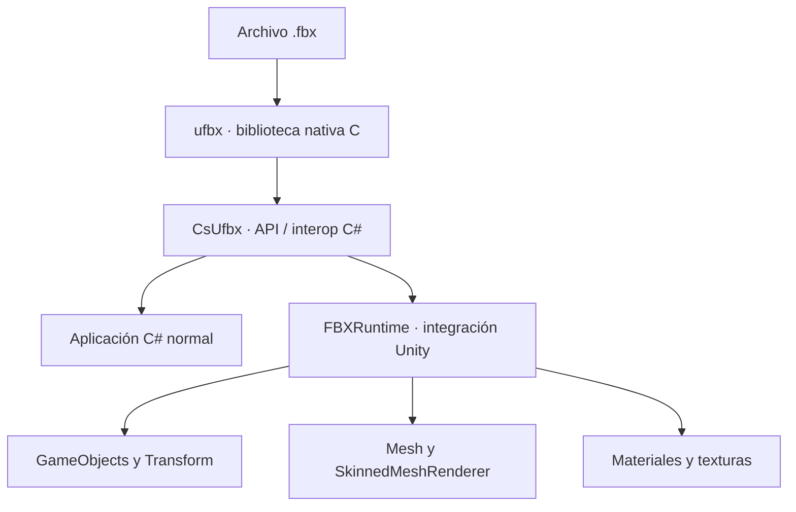

<div align="center">

# CsUfbx & FBXRuntime

**Carga archivos FBX desde C# y convierte escenas FBX en objetos de Unity durante la ejecución.**


[🇪🇸 Castellano](README.md) · [🇬🇧 English](README.en.md)

</div>

> [!WARNING]
> **Proyecto en desarrollo.** Lo básico de la carga y conversión de modelos ya está implementado, pero todavía faltan funciones importantes y hay casos de FBX que pueden no importarse correctamente. La API y el comportamiento pueden cambiar entre versiones. No se considera todavía un importador completo ni listo para producción.

## ✨ ¿Qué es?

Este repositorio reúne dos piezas relacionadas que usan la biblioteca nativa [**ufbx**](https://github.com/ufbx/ufbx), un lector de archivos FBX:

- **`CsUfbx`** proporciona una API para acceder a `ufbx` desde **C# convencional**, sin depender de las clases de Unity. Es la opción para herramientas de escritorio, aplicaciones .NET, utilidades o programas que necesiten leer la estructura de un FBX.
- **`FBXRuntime`** es la capa específica para **Unity**. Usa `CsUfbx` para leer la escena y crear objetos de Unity —jerarquía de `GameObject`, transformaciones, mallas, esqueletos y materiales— en tiempo de ejecución.

`CsUfbx` no es un lector FBX escrito íntegramente en código administrado: actúa como puente C# hacia la biblioteca nativa `ufbx`. Para ejecutarlo fuera de Unity también hay que integrar la biblioteca nativa correcta para la plataforma de destino.

## 🧩 Cómo encaja cada parte



| Componente | Para qué sirve | ¿Depende de Unity? |
|---|---|---|
| **ufbx** | Analiza el archivo FBX y expone sus datos. | No; es la biblioteca nativa de terceros. |
| **CsUfbx** | Expone funciones y estructuras de `ufbx` mediante C#. | **No** depende de `UnityEngine`, pero sí de la biblioteca nativa y de su interop. |
| **FBXRuntime** | Convierte los datos leídos en objetos que Unity puede utilizar. | **Sí**, utiliza `UnityEngine`. |

## ✅ Lo que ya funciona

La funcionalidad actual cubre una base útil para seguir construyendo el importador:

- Lectura de una escena FBX mediante `LoadScene`.
- Construcción de la jerarquía de nodos como `GameObject` y conversión de sus transformaciones.
- Creación de mallas estáticas y uso de `SkinnedMeshRenderer` para mallas con deformación por huesos.
- Asignación de huesos, *bind poses* y pesos de piel en el flujo actual.
- Creación de submallas y asignación de materiales a las mallas.
- Soporte inicial de propiedades de material como color base, rugosidad, suavidad y emisión.
- Carga y asignación de algunas texturas habituales, incluidas rutas externas y contenido embebido, para canales como color base, normales y emisión.
- Selección de un shader iluminado predeterminado para **Built-in Render Pipeline** y **URP**.

> Estas funciones constituyen una base de trabajo, no una garantía de compatibilidad con cualquier FBX. La conversión de materiales, UV, piel y otros datos todavía necesita mejoras y más pruebas.

## 🚧 Pendiente de desarrollar

La siguiente lista recoge las tareas marcadas en comentarios dentro de [`FBXRuntime.cs`](https://github.com/PabloGHub/CsUfbx-FBXRuntime/blob/master/FBXRuntime/FBXRuntime.cs), junto con otros puntos que el propio código deja sin terminar.

### Geometría y mallas

- [ ] Corregir el mapeado de las coordenadas **UV**.
- [ ] Importar las **tangentes del FBX** en lugar de depender de `Mesh.RecalculateTangents()`.
- [ ] Optimizar la creación y el procesamiento de mallas.
- [ ] Completar los casos pendientes de conversión de geometría, armaduras y mallas.

### Esqueletos, animación y escena

- [ ] Resolver los vértices que no tengan pesos de piel: interpolar usando los vértices vecinos cuando sea posible y, como último recurso, asignar el hueso inicial con un peso de `1.0`.
- [ ] Crear e importar **animaciones**.
- [ ] Crear e importar **BlendShapes**.
- [ ] Crear las **cámaras** de Unity a partir de las cámaras del FBX.
- [ ] Crear las **luces** de Unity a partir de las luces del FBX.
- [ ] Añadir configuración para decidir, entre otras cosas, si la raíz se interpreta en espacio local o global.

### Materiales y texturas

- [ ] Completar el mapeado de propiedades de shader y la asignación automática de texturas a las propiedades correspondientes.
- [ ] Evitar recrear objetos `Texture2D` en cada aplicación de propiedades; reutilizar o almacenar en caché las texturas.
- [ ] Completar el tratamiento de tipos de textura que actualmente están comentados o sin resolver, como las texturas *layered*, procedurales o generadas por shader.

### Exportación

- [ ] Implementar la exportación de un `GameObject` o una escena de Unity a FBX. Los métodos `Export(...)` de `FBXRuntime` están marcados actualmente como **WIP** y lanzan `NotImplementedException`.
- [ ] Implementar el guardado de escenas en archivo desde la capa `CsUfbx`, que también está marcado como pendiente.

## 🚀 Ejemplo mínimo en Unity

`FBXRuntime` ofrece `LoadScene(...)` para leer el archivo y `Instantiate(...)` para convertir la escena cargada en objetos de Unity. Como la API maneja punteros, el código que lo use debe permitir `unsafe`.

```csharp
using Ufbx;
using Ufbx.Runtime;
using UnityEngine;

public static class FbxLoaderExample
{
    public static unsafe GameObject Load(string path)
    {
        ufbx_error error = default;
        ufbx_scene* scene = FBXRuntime.LoadScene(path, &error);

        if (scene == null)
        {
            Debug.LogError($"No se pudo cargar el FBX: {error.description}");
            return null;
        }

        return FBXRuntime.Instantiate(scene);
    }
}
```

Este ejemplo solo muestra el flujo básico de carga e instanciación. Al integrarlo en una aplicación real, revisa también el ciclo de vida y la liberación de la memoria nativa de la escena, además del manejo de errores.

## 📦 Estructura del repositorio

```text
CsUfbx-FBXRuntime/
├── CsUfbx/             # Interop C# y fuentes nativas de ufbx
├── FBXRuntime/         # Conversión a objetos de Unity
└── Unity_6000.1.1f1/   # Proyecto de Unity usado para pruebas
```

## ⬇️ `ufbx`: repositorio y descarga

La versión más reciente que aparece en el changelog oficial consultado para esta documentación es **v0.23.1**, publicada el **24 de septiembre de 2026**. Puedes obtener el código fuente desde estos enlaces:

- **[Descargar ufbx v0.23.1 (ZIP)](https://github.com/ufbx/ufbx/archive/refs/tags/v0.23.1.zip)**
- [Repositorio oficial de ufbx](https://github.com/ufbx/ufbx)
- [Documentación oficial](https://ufbx.github.io/)
- [Changelog / historial de versiones](https://github.com/ufbx/ufbx/blob/main/misc/changelog.md)

**Nota sobre la versión incluida:** el `ufbx.h` que actualmente contiene este repositorio declara `UFBX_HEADER_VERSION` como **0.23.0**. Por tanto, el código fuente incluido aquí no es todavía la última versión upstream. Si actualizas `ufbx.c` y `ufbx.h` a v0.23.1, comprueba también las declaraciones/interoperabilidad C# y vuelve a probar la compilación: no conviene mezclar versiones de la API nativa y sus estructuras enlazadas sin verificar su compatibilidad.

## 🔗 Enlaces del proyecto

- [Repositorio CsUfbx-FBXRuntime](https://github.com/PabloGHub/CsUfbx-FBXRuntime)
- [Implementación de `CsUfbx`](https://github.com/PabloGHub/CsUfbx-FBXRuntime/blob/master/CsUfbx/CsUfbx.cs)
- [Implementación de `FBXRuntime`](https://github.com/PabloGHub/CsUfbx-FBXRuntime/blob/master/FBXRuntime/FBXRuntime.cs)

---

<p align="center"><sub>Proyecto en desarrollo · La importación básica ya está en marcha; el soporte completo de FBX aún está pendiente.</sub></p>
